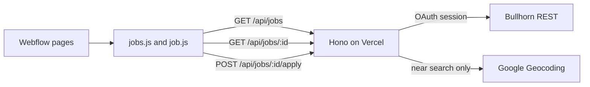

# Career Group Companies careers

pnpm monorepo. Webflow hosts the pages. A Hono API on Vercel reads published Bullhorn jobs and writes applications back. Bullhorn stays the system of record. Jobs are not copied into a Webflow CMS collection, and the browser never calls Bullhorn.

```
packages/
  frontend/   # jobs.js and job.js, loaded on the Webflow pages
  server/     # Hono API
```



## How a page load works

The listing page loads `jobs.js`. The detail page loads `job.js`. Each script reads `window.CAREERS_API_ORIGIN` when it is set, otherwise the origin baked in at build time: `http://localhost:8787` in development and `https://career-group.vercel.app` in production.

The API is one Hono app. Every request runs CORS, then a request id, then a request log. Routes are `GET /health`, `GET /api/jobs`, `GET /api/jobs/:id`, and `POST /api/jobs/:id/apply`. Anything else is `404`. An unexpected throw is `500` with `Request failed.` Errors use `Cache-Control: no-store`.

One Bullhorn client is kept for the life of the Node process. The first call logs in. Later calls reuse that session.

## Published jobs

A job is public when `isDeleted` is false and `isPublic` is on. Search uses `isDeleted:false AND isPublic:1`. `isPublic:true` matches nothing in this corp. A job whose publish date is in the future is dropped after the search. The publish date is Published Date (`customDate1`), or `dateLastPublished` when that field is empty. A job with no date still lists. A job with no public title is dropped. Closed jobs stay on the list while the public flag is still on.

`GET /api/jobs` also accepts `q`, `location`, and `category`. `q` is a title prefix. `location` is an exact city. `category` is an exact Job Function (`customText5`). `start` is 0–10,000 and defaults to 0. `count` is 1–200 and defaults to 50. The listing page does not send those three filters. It loads up to 500 published jobs, 200 at a time, and filters them in the browser. The only listing call that uses a server filter is the radius search.

`GET /api/jobs/:id` returns one published job, including the public description. A missing, deleted, unpublished, or future-dated job is `404`.

`near` is a place such as `Austin, TX`. The API geocodes it with Google and returns published jobs within 50 miles, scanning at most the first 500 published jobs. The radius is fixed. `GOOGLE_MAPS_API_KEY` stays on the server. An unknown place is `422` with `unresolved_location`.

| Careers value | JobOrder field |
| --- | --- |
| Publishing Status | `isPublic` (search `isPublic:1`) |
| Public title | `customText15`, then `title` |
| Location | `address.city` and the state abbreviation, such as `San Francisco, CA`. A non-US country stays on the line. `None Specified` is dropped. |
| Employment type | `employmentType` |
| Category | `customText5` (Job Function), then `publishedCategory.name` |
| Annual pay | `customFloat1` min, `customFloat2` max |
| Hourly pay | `payRate` min, `customFloat3` max, used when both annual amounts are empty |
| Hide salary | `customText12` = Yes blanks the amounts |
| Worksite | `customText10`. The card shows `Remote` or `Hybrid`. Onsite and blank stay hidden. `remote` is true only for Remote. |
| Division | `customText20` |
| Posted date | `customDate1`, then `dateLastPublished` |
| Public description | `publicDescription` on the detail page. Script and iframe tags are stripped before it is inserted as HTML. The card preview is `customText4` when set, otherwise a plain-text excerpt of `publicDescription`, cut near 220 characters. |

`clientBillRate` is not shown as pay. Division codes: `CG` Career Group, `SB` Syndicatebleu, `FF` Fourth Floor, `CGS` Career Group Search, `CGC` CGC Internal, `Event` or `Events` Career Group Events. An unknown code is shown as stored.

## Listing page

`jobs.js` clones the first `[dev-target="job-card-item"]` inside `[dev-target="jobs-list"]`, then removes that original. The card link is `detail-path` on the list, or `/dev/job-posting-dev`, plus `?id=`. Card text is filled through `fs-cmsfilter-field` (`title`, `location`, `type`, `category`, `salary`, `remote`). The division chip is `[dev-target="division-chip"]`. The worksite row is `[dev-target="remote-role"]`. The results line is `[dev-target="results"]` or `.results`. A job is marked new when `publishedAt` is on or after local midnight four days ago. While the first page is in flight, the list reads `Loading jobs…`.

Filters run in the script, 150ms after the last change. Checked values in one group match any of those values. Groups combine. The groups are division, remote only, employment type, salary, and job function. Clear Filters restores the loaded list.

Salary radios are annual minimums from $40,000 to $200,000. Hourly jobs are compared as annual pay using 2,080 hours. A job with no salary is hidden once a minimum is set. A single hourly rate renders as `$30/hr`. A range renders as `$30/hr–$36/hr`. Yearly amounts have no unit suffix. Employment options match more than one Bullhorn label: Direct Hire also matches Permanent, Temp to Hire also matches Contract to Hire, and Temp also matches Temporary and Contract.

The location box is different. After 400ms it calls `GET /api/jobs?near=`. A resolved place replaces the list with jobs inside 50 miles, and the other filters still apply. If Google cannot resolve the text, the script falls back to a case-insensitive match on the loaded job locations. It opens the error panel only when that fallback also matches nothing. Clearing the box returns to the loaded list.

The keyword box matches the title and location already loaded in the browser. It does not call the API.

## Detail page

The page URL is `/dev/job-posting-dev?id=123` for as long as that job stays published. `job.js` reads `id` from the query string. A missing or non-numeric id shows “This job link is incomplete.” A `404` shows “This job is no longer available.” A failed request shows “This job could not be loaded. Please try again.”

On load, the job body and the side cards start hidden. A successful job fills the title, location, type, category, salary, division, and description, sets the document title, colors `job-highlights` with the division color, and shows the matching division card. Every other division card stays hidden.

| Division | Color | Card |
| --- | --- | --- |
| Career Group | `#b9373d` | `division-card-career-grp` |
| Syndicatebleu | `#00abc7` | `division-card-syndicate` |
| Fourth Floor | `#51afe2` | `division-card-fourth-floor` |
| Career Group Search | `#bab4ae` | `division-card-career-grp-search` |
| Career Group Events | `#f62dae` | `division-card-career-grp-events` |
| CGC Internal | none | `division-card-career-grp-companies` |

The same colors are used for listing chips. CGC Internal has no chip color.

## Apply

The form is `[dev-target="apply-form"]` inside `[dev-target="form-wrapper"]`. The script sets `noValidate` and handles submit in the capture phase, so Webflow does not post the form itself. The submit button shows its `data-wait` label while the request is in flight.

The browser checks the fields first and joins every problem into one message. A failing field gets `is-error`. Typing or changing that field removes the class. The server checks the same rules again and returns the first problem.

| Form `dev-target` | Multipart field | Required | Limit |
| --- | --- | --- | --- |
| `first-name` | `firstName` | yes | 50 |
| `last-name` | `lastName` | yes | 50 |
| `email` | `email` | yes | 100, must be an email. The server lowercases it. |
| `phone` | `phone` | yes | 50 |
| `city` | `city` | yes | 100 |
| `state` | `state` | yes | 100 |
| `referral` | `referral` | yes | one of the eight labels below |
| `linkedin-url` | `linkedinUrl` | no | 100, http or https when present |
| `porfolio` | `portfolioUrl` | no | 100, http or https when present. The target spelling is `porfolio`. |
| `file-upload` | `resume` | yes | PDF, DOC, or DOCX, 10 MB |

Referral labels: I'm an existing candidate, Instagram, Internet Search, Email Marketing, LinkedIn, Pinterest, Referred by a peer, Others.

reCAPTCHA v3 runs only when `GOOGLE_RECAPTCHA_SECRET_KEY` is set. Until then the apply request is unchanged. With the secret set, the job page loads Google’s script from `window.GOOGLE_RECAPTCHA_SITE_KEY` (or `GOOGLE_RECAPTCHA_SITE_KEY` at build time), asks for a token with action `apply`, and sends it as `recaptchaToken`. The API checks that token with Google before it writes to Bullhorn. The token must succeed, use action `apply`, and score at least `RECAPTCHA_MIN_SCORE` (default 0.5). A failed check is “The security check failed. Please try again.” and creates no candidate. If the script cannot load, the page does not submit. OneTrust must allow `www.google.com` and `www.gstatic.com`.

```html
<script>
	window.GOOGLE_RECAPTCHA_SITE_KEY = 'site-key';
</script>
```

On success the script removes `hide` from `[dev-target="success-state"]` and adds `hide` to `[dev-target="form-wrapper"]`. It does not replace the success block’s copy. Field errors use `[dev-target="form-error-wrapper"]` and `[dev-target="form-error-text"]`. Showing a form error hides the success block again. Page-level problems use `[dev-target="error-wrapper"]`.

A non-JSON response, including a host rejecting the body before the handler runs, is shown as “Your application could not be submitted. Please try again.”

### What Bullhorn receives

The API confirms the job is still published, then:

1. `search/Candidate` with Lucene `email:"…"`. Candidate is an indexed entity, so `query/Candidate` is not used.
2. If that email exists, `POST entity/Candidate/{id}` updates the fields below and does not send `status`.
3. If it does not exist, `PUT entity/Candidate` creates one. `status` is sent only when `BULLHORN_CANDIDATE_STATUS` is set. This corp uses `New Lead`.
4. `query/JobSubmission` with `candidate.id` and `jobOrder.id`. A match means this person already applied to this job, so no second submission is created.
5. Otherwise `PUT entity/JobSubmission` with the candidate, the job, `status` from `BULLHORN_SUBMISSION_STATUS` (default `Web Response`), and `dateWebResponse` set to now.
6. The resume is uploaded with `PUT file/Candidate/{id}/raw` as multipart field `file`, `fileType=Resume`. This account does not accept files on a JobSubmission, so the file is attached to the candidate only. The upload runs on every accepted application, including a repeat application to the same job.

The same email on two jobs is one candidate and two submissions. The same email on the same job stays one submission. The response is `{ "ok": true, "alreadyApplied": false, "resumeAttached": true }`. `alreadyApplied` is true when step 4 found a submission. `resumeAttached` is false when step 6 fails. The API still returns 200 in that case, because the candidate and submission were already written. A Bullhorn failure before that is `502` with “Bullhorn is unavailable right now.”

The record created in step 5 is an internal JobSubmission. Bullhorn’s Web Response list is a different entity, `WebResponse`, and this API does not create one. The status string `Web Response` is stored on the JobSubmission. It is not in this corp’s JobSubmission status picklist.

| Form value | Candidate field |
| --- | --- |
| First name, last name | `firstName`, `lastName`, and `name` (the two names, cut at 100) |
| Email, phone | `email`, `phone` |
| City, state | `address.city`, `address.state` |
| Referral | `source`. Instagram stays Instagram. Internet Search becomes Internet/Google Search. LinkedIn becomes LinkedIn Search, stored with the non-breaking space already in that picklist option. Referred by a peer becomes Referral - Applicant referred Applicant. I'm an existing candidate, Email Marketing, Pinterest, and Others become Other. |
| LinkedIn URL | `customText8`, only when the field is filled |
| Portfolio URL | `companyURL`, only when the field is filled |
| New candidate only | `status` from `BULLHORN_CANDIDATE_STATUS` |

An update does not overwrite recruiter fields that the form does not send.

### Resume size on Vercel

The app accepts a resume up to 10 MB. Vercel rejects a function body over about 4.5 MB before this handler runs, so a file between those sizes works on the local API and fails on the live API. The live failure is not the app’s “Resume must be 10 MB or smaller.” message, because the body never reaches it.

## Bullhorn login

The API discovers the cluster with `GET rest-services/loginInfo?username=`, then follows Bullhorn’s REST login: authorize (`response_type=code`, `action=Login`, username, password, `redirect_uri`), exchange that code at the token URL, then `POST rest-services/login?version=*&access_token=`. Later calls use the returned `restUrl` and `BhRestToken`.

The registered redirect URI must be exactly `http://www.bullhorn.com`. The session stays in memory until 30 seconds before the token expires. It then uses the refresh token, and logs in again only if refresh fails. A `401` clears the session and retries the call once. A new API user has to accept Bullhorn’s OAuth consent page once for this client id before a code is returned. That consent is not part of the careers pages.

This uses JobOrder, Candidate, JobSubmission, and the candidate file endpoint. It does not use the Bullhorn Open Source Career Portal, and it does not create custom fields.

Bullhorn’s ATS API usage limits, per OAuth client id, are 1,500 requests per minute, 100,000 calls per month unless the contract says otherwise, 50 concurrent sessions, and 50 event subscriptions. This integration does not use subscriptions. Over the per-minute cap, Bullhorn returns HTTP 429. This API does not retry those. Their list endpoints document a maximum `count` of 500. This API never asks for more than 200.

## Caching

Job reads are cached in two places. Applications and errors are not.

**Vercel CDN.** `GET /api/jobs` and `GET /api/jobs/:id` send `Cache-Control: public, s-maxage=300, stale-while-revalidate=600`. The edge can serve a response for 5 minutes, then keep serving that copy for another 10 minutes while it fetches a fresh one. There is no `max-age`, so the browser is not told to keep its own copy.

**Server memory.** The Bullhorn client in a warm Node process keeps:

- Each job list, including a `near` search, for 5 minutes, keyed by the query.
- Each published job detail for 5 minutes, keyed by id. A missing or unpublished job is not stored.
- Geocoded places for the life of the process, including places Google could not resolve.
- The Bullhorn session until 30 seconds before the token expires.

That memory lives only as long as the server instance. A cold start talks to Bullhorn and Google again. `POST /api/jobs/:id/apply` and every error response use `Cache-Control: no-store`. The frontend does not cache responses.

## CORS

`CORS_ORIGINS` is a comma-separated list, or `*`. When the list is restricted, `careergroupcompanies.com`, `webflow.io`, and their subdomains are still allowed. Allowed methods are `GET`, `HEAD`, `POST`, and `OPTIONS`. A preflight returns `204`.

## Webflow markup

Load `jobs.js` on the listing page and `job.js` on the detail page. Local dev:

```html
<script>
	window.CAREERS_API_ORIGIN = 'http://localhost:8787';
</script>
<script type="module" src="http://localhost:3000/pages/jobs.js"></script>
```

Production loads the built files from jsDelivr at a pinned commit. The scripts call `https://career-group.vercel.app`. Set `window.CAREERS_API_ORIGIN` on the page only when that host should change without a rebuild.

```html
<script>
	window.CAREERS_API_ORIGIN = 'https://career-group.vercel.app';
</script>
<script
	defer
	src="https://cdn.jsdelivr.net/gh/<org>/<repo>@<commit>/packages/frontend/dist/pages/jobs.js"
></script>
```

OneTrust must allow jsDelivr and the Vercel API host.

Listing targets: `jobs-list`, `job-card-item`, `search-input`, `location-search-input`, `division-checkbox-wrapper`, `remote-only-checkbox-wrapper`, `employment-type-checkbox-wrapper`, `salary-radio-wrapper`, `job-function-checkbox-wrapper`, and `clear`.

Detail markup:

```html
<div dev-target="job-highlights" class="job-highlights">
	<p dev-target="job-location"></p>
	<p dev-target="job-salary"></p>
	<p dev-target="job-type"></p>
	<p dev-target="job-category"></p>
	<p dev-target="division"></p>
</div>
<div dev-target="division-card-career-grp" class="division-details"></div>
<div dev-target="division-card-syndicate" class="division-details"></div>
<div dev-target="division-card-fourth-floor" class="division-details"></div>
<div dev-target="division-card-career-grp-search" class="division-details"></div>
<div dev-target="division-card-career-grp-events" class="division-details"></div>
<div dev-target="division-card-career-grp-companies" class="division-details"></div>

<h1 dev-target="job-title"></h1>
<div dev-target="job-description"></div>

<div dev-target="form-wrapper">
<form dev-target="apply-form">
	<input dev-target="first-name" required />
	<input dev-target="last-name" required />
	<input dev-target="email" type="email" required />
	<input dev-target="phone" type="tel" required />
	<input dev-target="city" required />
	<input dev-target="state" required />
	<select dev-target="referral" required></select>
	<input dev-target="file-upload" type="file" accept=".pdf,.doc,.docx" required />
	<input dev-target="linkedin-url" type="url" />
	<input dev-target="porfolio" type="url" />
	<input type="submit" value="Submit" />
</form>
</div>
<div dev-target="form-error-wrapper" class="hide">
	<p dev-target="form-error-text"></p>
</div>
<div dev-target="success-state" class="hide"></div>

<div dev-target="error-wrapper" class="hide">
	<p dev-target="error-text"></p>
	<button type="button" dev-target="cancel">Close</button>
</div>
```

## Configuration

The Vercel project root is `packages/server`. Copy `packages/server/.env.example` to `packages/server/.env` for local credentials. Do not commit `.env`.

```
BULLHORN_CLIENT_ID
BULLHORN_CLIENT_SECRET
BULLHORN_API_USERNAME
BULLHORN_API_PASSWORD
BULLHORN_REDIRECT_URI=http://www.bullhorn.com
BULLHORN_SUBMISSION_STATUS=Web Response
BULLHORN_CANDIDATE_STATUS=New Lead
CORS_ORIGINS=https://www.careergroupcompanies.com,https://careergroupcompanies.com
GOOGLE_MAPS_API_KEY=
GOOGLE_RECAPTCHA_SECRET_KEY=
GOOGLE_RECAPTCHA_SITE_KEY=
RECAPTCHA_MIN_SCORE=0.5
```

`BULLHORN_CANDIDATE_STATUS` is sent only when it is set, and only when a candidate is created.

| Command | Description |
| --- | --- |
| `pnpm dev` | Frontend on port 3000 and API on port 8787 |
| `pnpm test` | API tests |
| `pnpm --filter @career-group/server deploy` | Production deploy of the API |
| `pnpm --filter @career-group/frontend build` | Write `packages/frontend/dist` |

`pnpm dev` serves the same Hono app Node uses locally. The frontend watcher rebuilds `dist`. The API process does not reload on its own, so a server or `.env` change needs a restart. Production is that app's default export, which Vercel runs as a Hono project. The live API origin is `https://career-group.vercel.app`.
